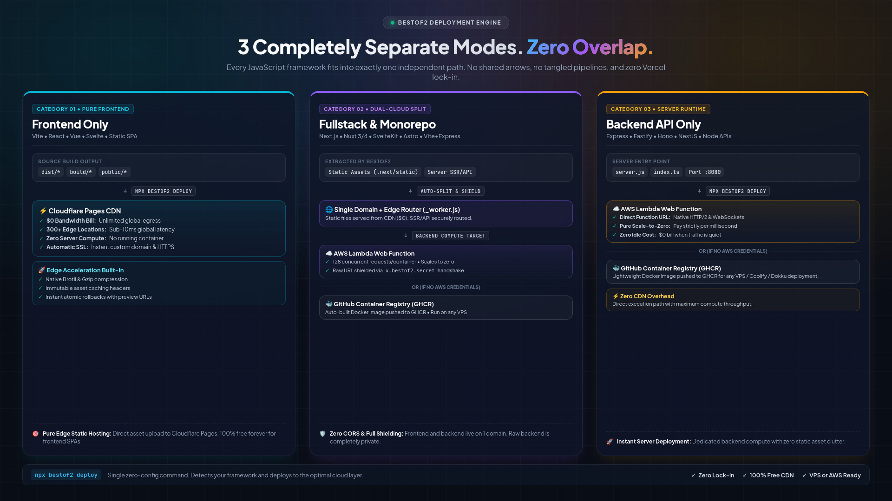

# bestof2 🏆

> **"Frontend on Cloudflare Pages (100% Free CDN). Backend on AWS Lambda Web Functions or docker image to deploy anywhere. One single command."**

The zero-lockin, dual-cloud deployment engine for modern JavaScript full-stack frameworks, decoupled monorepos, and Node.js backends. Single unified domain. Zero adapters. Zero DevOps. 100% Framework Agnostic.



---

## ⚡ GitHub Marketplace Action

Deploy any full-stack app automatically on every `git push`. Add `.github/workflows/deploy.yml` to your repository:

```yaml
name: Deploy
on:
  push:
    branches: [main]
  workflow_dispatch:

jobs:
  deploy:
    runs-on: ubuntu-latest
    permissions:
      contents: read
      packages: write # For GHCR container push fallback
    steps:
      - uses: actions/checkout@v4

      - name: 🚀 Deploy with BestOf2
        uses: arcopscloud/bestof2@v1
        with:
          cloudflare-api-token: ${{ secrets.CLOUDFLARE_API_TOKEN }}
          bestof2-secret: ${{ secrets.BESTOF2_SECRET }}
          aws-access-key-id: ${{ secrets.AWS_ACCESS_KEY_ID }}
          aws-secret-access-key: ${{ secrets.AWS_SECRET_ACCESS_KEY }}
          aws-deployment-bucket: ${{ secrets.AWS_DEPLOYMENT_BUCKET }}
```

- **Dual-Cloud Deploy**: Frontend deploys to Cloudflare Pages CDN ($0) + Backend deploys to AWS Lambda Web Functions.
- **Self-Host Fallback ($0 AWS Cost)**: If `aws-access-key-id` is omitted, it automatically builds a `node:24-alpine` container, pushes to GHCR, and outputs your ready-to-run VPS command.
- **Pure Frontend Auto-Skip**: Static frontend apps (Vite, React, Vue) deploy to Cloudflare Pages and automatically skip all Docker/backend steps.

---

## 🛠️ 1-Click AWS IAM & S3 Setup (CloudFormation)

If you don't have AWS credentials configured yet, launch our automated least-privilege CloudFormation template [`cloudformation-template.yaml`](./cloudformation-template.yaml):

1. Go to **AWS CloudFormation Console** ➡️ **Create Stack** (with new resources) ➡️ **Upload a template file** (`cloudformation-template.yaml`).
2. Once the stack finishes creating (~60 seconds), click the **Outputs** tab.
3. Copy the auto-generated credentials directly into your `.env` or GitHub Secrets:
   - `AWS_ACCESS_KEY_ID`
   - `AWS_SECRET_ACCESS_KEY`
   - `AWS_DEPLOYMENT_BUCKET` *(Auto-generated globally unique S3 bucket with automatic 30-day artifact lifecycle cleanup)*
   - `AWS_DEFAULT_REGION`


---

## 🚀 Supported Frameworks & Architectures (98% of the Web)

`bestof2` automatically detects your project architecture at build time with **zero configuration**:

| Framework / Architecture | Frontend Target (Cloudflare Pages) | Backend Target (AWS Lambda Web Functions) | Edge Networking |
| :--- | :--- | :--- | :--- |
| **Next.js** (App & Pages Router) | `.next/static/*` + `public/*` | `.next/standalone/server.js` | Auto-wired (`_worker.js`) |
| **Nuxt 3 / Nuxt 4** (Nitro Engine) | `.output/public/*` | `.output/server/index.mjs` | Auto-wired (`_worker.js`) |
| **SvelteKit** | `build/client/*` | `build/index.js` (`adapter-node`) | Auto-wired (`_worker.js`) |
| **Astro SSR** | `dist/client/*` | `dist/server/entry.mjs` (`@astrojs/node`)| Auto-wired (`_worker.js`) |
| **React Router v7 / Remix** | `build/client/*` | `build/server/index.js` | Auto-wired (`_worker.js`) |
| **Decoupled Monorepo** (`frontend/` + `backend/`) | `frontend/dist/*` (Vite / React / Vue) | `backend/server.js` (Express / Hono) | Auto-wired `/api/*` (Zero CORS) |
| **Pure Frontend SPAs** (Vite, React, Vue) | `dist/*` | *None (0 compute, $0 bill)* | Direct CDN |
| **Pure Backend APIs** (Express, Fastify, Hono, NestJS) | *None* | Node.js Server on `:8080` | Direct Lambda Web URL |

---

## 🛡️ Raw Lambda URL Shielding & Security

When AWS Lambda Web Functions are deployed, AWS assigns an endpoint URL. **BestOf2 completely shields this URL from public exposure:**

1. **Single Public URL:** End users and browsers ONLY ever see `https://yourdomain.com` (or `your-app.pages.dev`). The raw Lambda URL is never exposed.
2. **Secret Header Handshake (`x-bestof2-secret`):**
   * At deploy time, BestOf2 injects a cryptographic secret token into Cloudflare Pages environment variables (`BESTOF2_SECRET`).
   * On every proxied request, Cloudflare's `_worker.js` injects `x-bestof2-secret: <token>`.
   * Any direct hit to the raw Lambda endpoint bypasses Cloudflare and returns `403 Forbidden`.
3. **Zero CORS Issues for Monorepos:** Because `frontend/` and `backend/` live under the exact same domain, cookies, authentication headers, and fetch calls work with zero cross-origin configuration.

---

## 📄 Links & License
- **GitHub Repository**: [https://github.com/arcopscloud/bestof2](https://github.com/arcopscloud/bestof2)
- **License**: MIT © ArcOps Cloud Contributors
